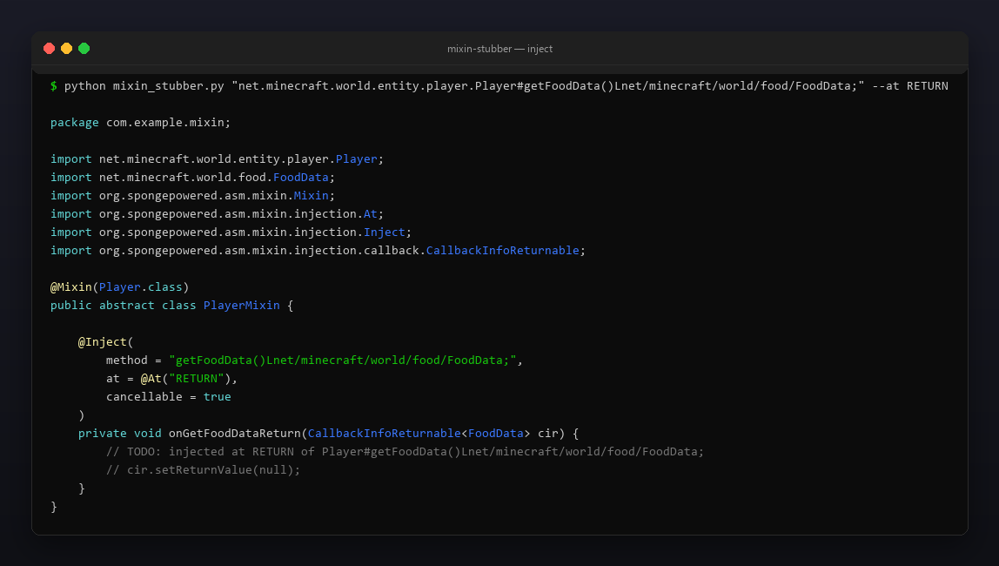
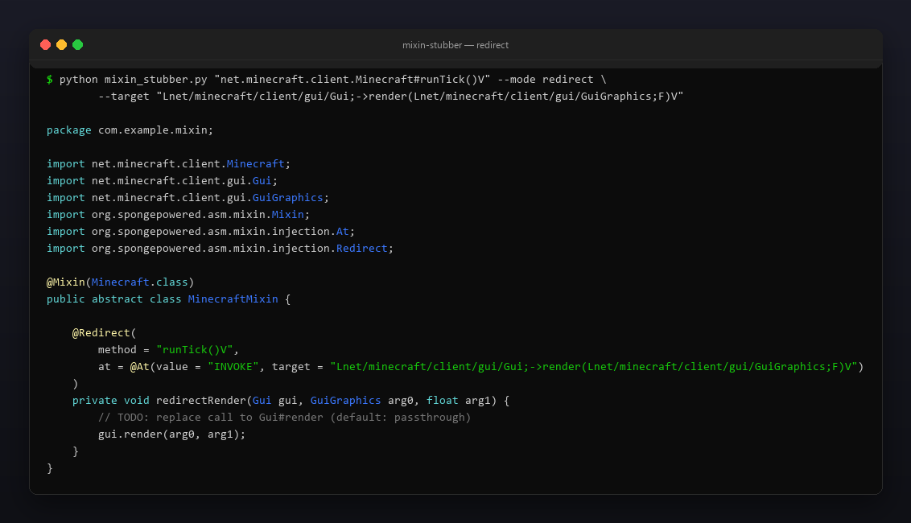

# mixin-stubber

[](https://github.com/Celine1337/mixin-stubber/actions/workflows/ci.yml)
[](https://github.com/Celine1337/mixin-stubber/releases)
[](LICENSE)
[](https://www.python.org/)

Paste a vanilla Minecraft method signature — get a ready-to-use SpongePowered
`@Mixin` class: `@Inject` / `@Redirect`, `at = @At(...)`, `CallbackInfo` /
`CallbackInfoReturnable<T>`, imports and handler parameters, all wired up.

Single file, standard library only, Python 3.9+. Understands Mojmap,
intermediary and SRG names. Fabric or Forge — the generated stub is plain
Mixin, drop it into your mod and fill in the `TODO`.



## Features

- **Five signature formats** — ASM, `Class#method(descriptor)`, readable Java,
  return-first, and bare intermediary/SRG names (see below).
- **`@Inject`** at `HEAD`, `TAIL`, `RETURN` or `INVOKE`; auto `cancellable = true`
  for non-void `RETURN`, with a commented `cir.setReturnValue(...)` carrying a
  type-correct default (`0`, `0L`, `0.0F`, `false`, `null`, ...).
- **`@Redirect`** with a fully built `@At(value = "INVOKE", target = "L...;->m(...)R")`,
  receiver instance + target args as handler parameters, and a passthrough call
  as the starting body. `--target-static` for static targets.
- **Overload-safe `method` strings** — JVM descriptors are reconstructed from
  readable types whenever the packages are known.
- **Correct callback types** — `CallbackInfo` for void, boxed
  `CallbackInfoReturnable<Integer>` / `<FoodData>` / ... otherwise.
- **Import management** — mixin annotations and every referenced type are
  imported; unresolvable simple names get a `// TODO: add imports for: ...` list.
- Constructors (`<init>`, `<clinit>`), generics-aware argument splitting, arrays.
- stdout or `--out File.java` (`--force` to overwrite); interactive prompt when
  run without arguments.

## Quick start

```console
$ python mixin_stubber.py "net.minecraft.world.entity.player.Player#tick()V"
```

```java
package com.example.mixin;

import net.minecraft.world.entity.player.Player;
import org.spongepowered.asm.mixin.Mixin;
import org.spongepowered.asm.mixin.injection.At;
import org.spongepowered.asm.mixin.injection.Inject;
import org.spongepowered.asm.mixin.injection.callback.CallbackInfo;

@Mixin(Player.class)
public abstract class PlayerMixin {

    @Inject(method = "tick()V", at = @At("HEAD"))
    private void onTickHead(CallbackInfo ci) {
        // TODO: injected at HEAD of Player#tick()V
    }
}
```

No install, no dependencies — clone and run.

## Signature formats

| Format | Example |
| --- | --- |
| ASM | `Lnet/minecraft/client/Minecraft;->runTick()V` |
| Hash + JVM descriptor | `net.minecraft.client.Minecraft#runTick()V` |
| Readable Java | `net.minecraft.client.Minecraft.runTick(boolean)` |
| Return-first | `int net.minecraft.util.Mth#clamp(int,int,int)` |
| Bare (intermediary / SRG) | `net.minecraft.class_310#method_1523` |

Notes:

- JVM descriptors (`(IF)Ljava/lang/String;`, arrays, primitives) are parsed and
  turned back into Java types for the handler signature.
- Readable types rebuild the descriptor when every type is fully qualified or
  primitive; otherwise the `method` string falls back to the bare name.
- Bare names (no parentheses) generate a stub plus a
  `// NOTE: no descriptor given - add one if the target method is overloaded`
  comment — handy for intermediary/SRG where you only have `class_310#method_1523`.

## Modes and flags

```console
$ python mixin_stubber.py SIGNATURE [--mode inject|redirect] [--at HEAD|TAIL|RETURN|INVOKE]
                                    [--target SIG] [--target-static] [--static]
                                    [--cancellable] [--package PKG] [--name NAME]
                                    [--out FILE] [--force]
```

| Flag | Meaning |
| --- | --- |
| `--mode` | `inject` (default) or `redirect` |
| `--at` | injection point for inject; redirect always uses `INVOKE` |
| `--target` | called method for `INVOKE` / redirect, any signature format |
| `--target-static` | redirect target is static (no receiver parameter) |
| `--static` | target method is static → static handler |
| `--cancellable` | force `cancellable = true` |
| `--package` | mixin package (default `com.example.mixin`) |
| `--name` | mixin class name (default `<Target>Mixin`) |
| `--out` / `--force` | write to a file / overwrite it |

### Redirect

```console
$ python mixin_stubber.py "net.minecraft.client.Minecraft#runTick()V" --mode redirect \
    --target "Lnet/minecraft/client/gui/Gui;->render(Lnet/minecraft/client/gui/GuiGraphics;F)V"
```



The handler receives the receiver instance (`Gui gui`) followed by the target's
arguments, returns the target's return type, and starts with a passthrough call
so the stub compiles and behaves identically until you edit it.

### More examples

```console
# non-void RETURN: CallbackInfoReturnable + cancellable + setReturnValue hint
$ python mixin_stubber.py "net.minecraft.world.entity.player.Player#getFoodData()Lnet/minecraft/world/food/FoodData;" --at RETURN

# static target: no receiver, static passthrough
$ python mixin_stubber.py "net.minecraft.util.Mth#clamp(III)I" --mode redirect \
    --target "int net.minecraft.util.Mth#clamp(int,int,int)" --target-static

# constructor injection
$ python mixin_stubber.py "net.minecraft.world.entity.player.Player#<init>(Lnet/minecraft/world/level/Level;)V"

# straight into your mod source tree
$ python mixin_stubber.py "net.minecraft.class_310#method_1523" --package dev.mymod.mixin --out src/main/java/dev/mymod/mixin/MinecraftClientMixin.java
```

## Tests

```console
$ python -m unittest discover -s tests -v
```

33 tests cover parsing (all formats, arrays, generics, constructors, bad input)
and generation (inject/redirect, static, cancellable, imports, CLI).

## Regenerating the screenshots

```console
$ pip install pillow
$ python tools/make_shots.py        # docs/inject.png, docs/redirect.png
$ python tools/social_preview.py    # docs/social-preview.png (repo social card)
```

## License

[MIT](LICENSE)