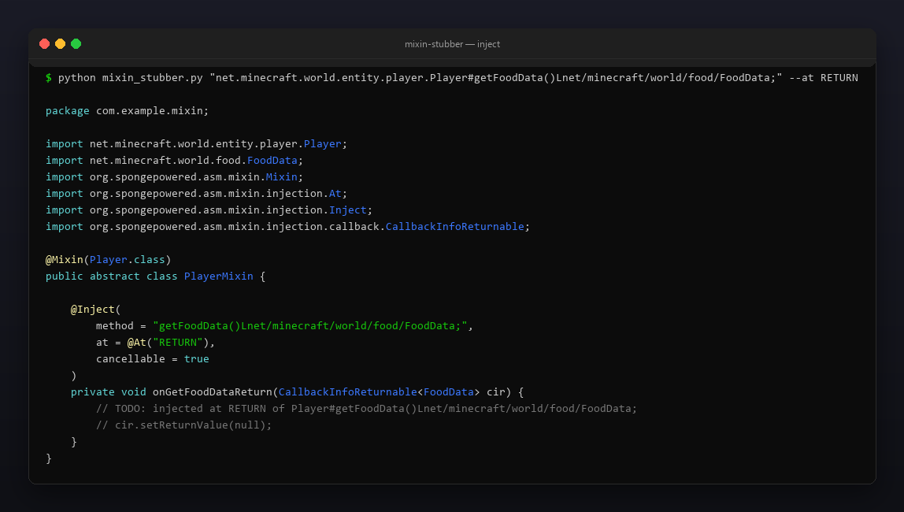
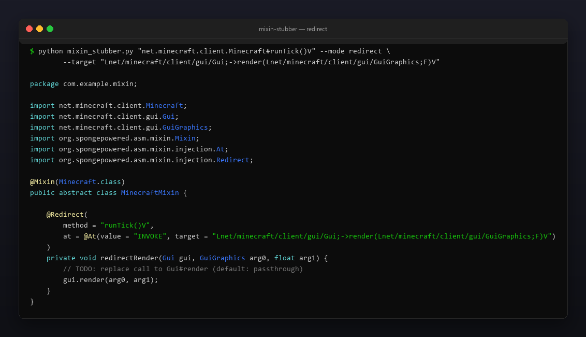

<p align="center"></p>

<p align="center">
  <a href="README.md"></a>
  <a href="https://github.com/Celine1337/mixin-stubber/releases"></a>
  <a href="https://github.com/Celine1337/mixin-stubber/actions/workflows/ci.yml"></a>
  <a href="LICENSE"></a>
</p>


Вставляешь сигнатуру метода из ванильного Minecraft — получаешь готовый класс
SpongePowered `@Mixin`: `@Inject` / `@Redirect`, `at = @At(...)`, `CallbackInfo` /
`CallbackInfoReturnable<T>`, импорты и параметры хендлера — всё уже расставлено.

Один файл, только стандартная библиотека, Python 3.9+. Понимает Mojmap,
intermediary и SRG-имена. Fabric или Forge — сгенерированный стаб это обычный
Mixin: кидаешь в мод и заполняешь `TODO`.


- **Пять форматов сигнатур** — ASM, `Class#method(дескриптор)`, читаемый Java,
  return-first и голые intermediary/SRG-имена (см. ниже).
- **`@Inject`** в `HEAD`, `TAIL`, `RETURN` или `INVOKE`; автоматический
  `cancellable = true` для non-void `RETURN` и закомментированный
  `cir.setReturnValue(...)` с дефолтом нужного типа (`0`, `0L`, `0.0F`, `false`, `null`, ...).
- **`@Redirect`** с полностью собранным `@At(value = "INVOKE", target = "L...;->m(...)R")`,
  instance-получатель + аргументы цели в параметрах хендлера и passthrough-вызов
  в теле. `--target-static` для статических целей.
- **Overload-safe строки `method`** — JVM-дескрипторы восстанавливаются из
  читаемых типов, когда известны пакеты.
- **Правильные типы коллбэков** — `CallbackInfo` для void, иначе боксированный
  `CallbackInfoReturnable<Integer>` / `<FoodData>` / ...
- **Импорты** — аннотации Mixin и все упомянутые типы импортируются;
  неразрешимые простые имена попадают в список `// TODO: add imports for: ...`.
- Конструкторы (`<init>`, `<clinit>`), разбор аргументов с учётом дженериков, массивы.
- stdout или `--out File.java` (`--force` для перезаписи); интерактивный ввод,
  если запустить без аргументов.


| Формат | Пример |
| --- | --- |
| ASM | `Lnet/minecraft/client/Minecraft;->runTick()V` |
| Hash + JVM-дескриптор | `net.minecraft.client.Minecraft#runTick()V` |
| Читаемый Java | `net.minecraft.client.Minecraft.runTick(boolean)` |
| Return-first | `int net.minecraft.util.Mth#clamp(int,int,int)` |
| Голые (intermediary / SRG) | `net.minecraft.class_310#method_1523` |

- JVM-дескрипторы (`(IF)Ljava/lang/String;`, массивы, примитивы) разбираются и
  превращаются обратно в Java-типы для сигнатуры хендлера.
- Читаемые типы пересобирают дескриптор, если каждый тип fully qualified или
  примитив; иначе строка `method` падает обратно к голому имени.
- Голые имена (без скобок) генерируют стаб плюс комментарий
  `// NOTE: no descriptor given - add one if the target method is overloaded` —
  удобно для intermediary/SRG, где есть только `class_310#method_1523`.
- Цель `INVOKE` / redirect обязана нести тип возврата (`int pkg.Cls#m(int)` или
  `Lpkg/Cls;->m(I)I`): угадывание `V` молча ломало бы стаб.


```console
$ python mixin_stubber.py "net.minecraft.world.entity.player.Player#tick()V"
```

```java
package com.example.mixin;

import net.minecraft.world.entity.player.Player;
import org.spongepowered.asm.mixin.Mixin;
import org.spongepowered.asm.mixin.injection.At;
import org.spongepowered.asm.mixin.injection.Inject;
import org.spongepowered.asm.mixin.injection.callback.CallbackInfo;

@Mixin(Player.class)
public abstract class PlayerMixin {

    @Inject(method = "tick()V", at = @At("HEAD"))
    private void onTickHead(CallbackInfo ci) {
        // TODO: injected at HEAD of Player#tick()V
    }
}
```

Без установки и зависимостей — клонируй и запускай.

| Флаг | Значение |
| --- | --- |
| `--mode` | `inject` (по умолчанию) или `redirect` |
| `--at` | точка инъекции для inject; redirect всегда `INVOKE` |
| `--target` | вызываемый метод для `INVOKE` / redirect, любой формат сигнатуры |
| `--target-static` | цель redirect статическая (без параметра-получателя) |
| `--static` | целевой метод статический → статический хендлер |
| `--cancellable` | форсировать `cancellable = true` |
| `--package` | пакет миксина (по умолчанию `com.example.mixin`) |
| `--name` | имя класса миксина (по умолчанию `<Target>Mixin`) |
| `--out` / `--force` | писать в файл / перезаписать его |

Redirect: хендлер получает instance-получатель (`Gui gui`), затем аргументы
цели, возвращает тип возврата цели и стартует с passthrough-вызова — стаб
компилируется и ведёт себя идентично, пока ты его не отредактируешь.

```console
# non-void RETURN: CallbackInfoReturnable + cancellable + подсказка setReturnValue
$ python mixin_stubber.py "net.minecraft.world.entity.player.Player#getFoodData()Lnet/minecraft/world/food/FoodData;" --at RETURN

# статическая цель: без получателя, статический passthrough
$ python mixin_stubber.py "net.minecraft.world.entity.player.Player#tick()V" --mode redirect \
    --target "int net.minecraft.util.Mth#clamp(int,int,int)" --target-static

# инъекция в конструктор
$ python mixin_stubber.py "net.minecraft.world.entity.player.Player#<init>(Lnet/minecraft/world/level/Level;)V"

# сразу в дерево исходников мода
$ python mixin_stubber.py "net.minecraft.class_310#method_1523" --package dev.mymod.mixin --out src/main/java/dev/mymod/mixin/MinecraftClientMixin.java
```







```console
$ python -m unittest discover -s tests -v
```

33 теста: парсинг (все форматы, массивы, дженерики, конструкторы, битый ввод)
и генерация (inject/redirect, static, cancellable, импорты, CLI).
Скриншоты и карточки пересобираются:

```console
$ pip install pillow
$ python tools/make_shots.py        # docs/inject.png, docs/redirect.png
$ python tools/make_style.py tools/style.json docs/style
```


[MIT](LICENSE) © Celine1337
